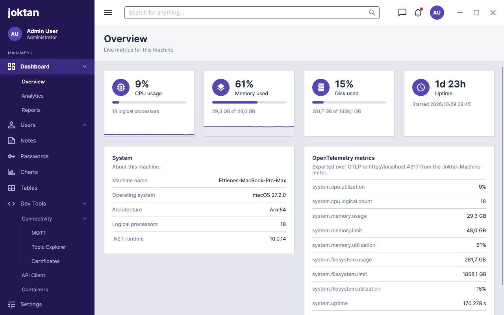
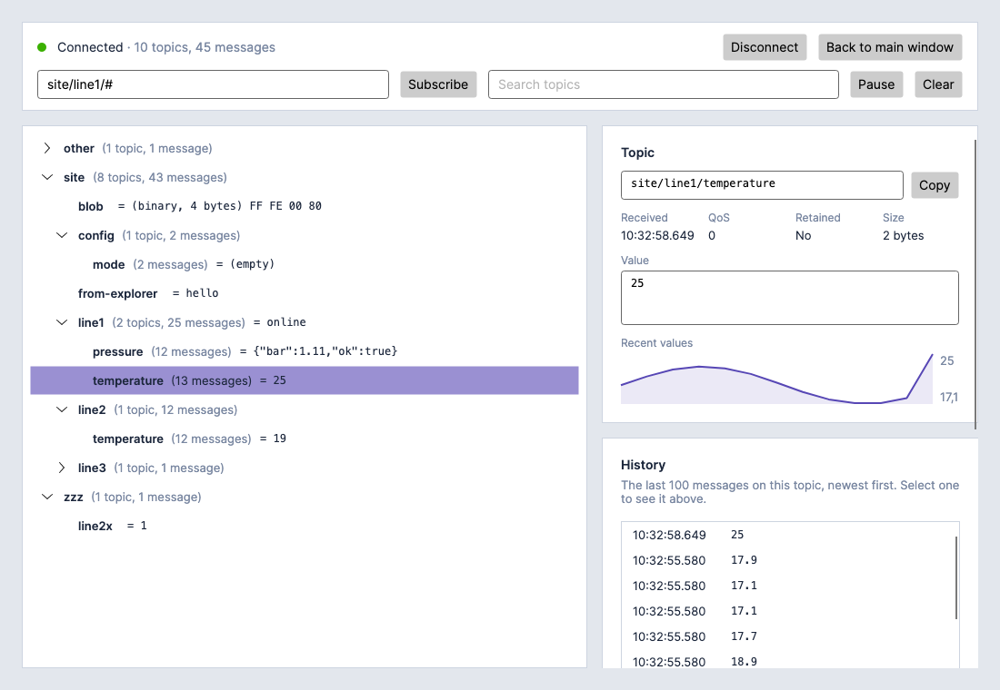

# Joktan

A cross-platform desktop admin application built with [Avalonia UI](https://avaloniaui.net/) and
.NET. It runs on Windows, Linux and macOS from one codebase.



The project is at an early stage. So far it has the application shell, a dashboard of local
machine metrics, two MQTT tools, a publisher for sending test messages and a topic explorer
for watching a broker, a page for making the certificates they use for TLS, a REST and gRPC client, and notes written in
Markdown, with pages that nest below one another, and a password manager that keeps logins in folders in an
encrypted vault or the system keychain. The other pages are placeholders.

## Requirements

- [.NET 10 SDK](https://dotnet.microsoft.com/download)

## Run

```sh
dotnet run
```

## Publish

Build a self-contained app for a given platform by passing its runtime identifier:

```sh
dotnet publish -c Release -r win-x64 --self-contained -o bin/publish/win-x64
dotnet publish -c Release -r linux-x64 --self-contained -o bin/publish/linux-x64
dotnet publish -c Release -r osx-arm64 --self-contained -o bin/publish/osx-arm64
```

Other identifiers such as `win-arm64`, `linux-arm64` and `osx-x64` work the same way.

## Dev tools

**Dev Tools / Connectivity / MQTT** sends test messages to MQTT brokers, typed in by hand or read from
a folder of JSON files, on a schedule and with fields that change on every send. Each client has
its own tab, broker, folder and activity log, any number can be connected at once, and each can
use TLS or mutual TLS with certificates from PEM or PFX/P12 files. It is specified
in [docs/features/dev-tools/connectivity/mqtt/spec.md](docs/features/dev-tools/connectivity/mqtt/spec.md).

**Dev Tools / Connectivity / Topic Explorer** has a tab per client; each subscribes to that
client's broker and shows every topic as a tree with its latest value, history and a publish
form. It can be moved into a window of its own. It is specified in
[docs/features/dev-tools/connectivity/topic-explorer/spec.md](docs/features/dev-tools/connectivity/topic-explorer/spec.md).

**Dev Tools / Connectivity / Certificates** makes certificate authorities, and the server and
client certificates they sign, for brokers and clients using TLS and mutual TLS. Any number of
CAs can be made, each certificate is kept below the CA that signed it, and the subject, key and
expiry date of each can be set, starting from defaults that can be changed. Certificates can be
exported for a broker and picked in a client's settings. It is specified in
[docs/features/dev-tools/connectivity/certificates/spec.md](docs/features/dev-tools/connectivity/certificates/spec.md).

**Dev Tools / Containers** starts, stops, restarts and takes down the services in one or more
compose files, `containers/docker-compose.yml` by default, with Docker or Podman, shows whether each is
running and on which ports, and shows their logs as they are written. It is specified in
[docs/features/dev-tools/containers/spec.md](docs/features/dev-tools/containers/spec.md).



To try them:

1. Start the local broker with **Start** on Dev Tools / Containers, or with Docker or Podman
   (see [containers/](containers/README.md)):

   ```sh
   docker compose -f containers/docker-compose.yml up -d
   ```

2. In Joktan, open Dev Tools / Connectivity / MQTT and connect the `main` client, which points at
   host `localhost`, port `1883`. To try TLS or mutual TLS, make the broker's certificates on
   Dev Tools / Connectivity / Certificates, or use its development ones, as
   [containers/README.md](containers/README.md#tls-and-mutual-tls) describes, and add a client
   for port 8883 or 8884.
3. Press **Choose folder** and pick `samples/mqtt-messages`. Every message starts switched off;
   turn on a message, or a whole group, with the switch in the **On** column.
4. Open Dev Tools / Connectivity / Topic Explorer to watch the messages arrive.

## Telemetry

Joktan uses [OpenTelemetry](https://opentelemetry.io/) and exports metrics and traces over OTLP.
By default it sends to a collector at `http://localhost:4317` using gRPC. If nothing is listening
there, the app runs normally and the data is dropped.

The standard environment variables change where it goes:

```sh
OTEL_EXPORTER_OTLP_ENDPOINT=http://localhost:4318 OTEL_EXPORTER_OTLP_PROTOCOL=http/protobuf dotnet run
```

Set `OTEL_SDK_DISABLED=true` to turn telemetry off.

The `Joktan.Machine` meter reports the local machine every two seconds. The same readings drive
the dashboard.

| Instrument | Unit | Meaning |
| --- | --- | --- |
| `system.cpu.utilization` | `1` | Share of CPU time in use across all cores |
| `system.cpu.logical.count` | `{cpu}` | Number of logical processors |
| `system.memory.usage` | `By` | Physical memory in use |
| `system.memory.limit` | `By` | Total physical memory |
| `system.memory.utilization` | `1` | Share of physical memory in use |
| `system.filesystem.usage` | `By` | Space in use on the system drive |
| `system.filesystem.limit` | `By` | Capacity of the system drive |
| `system.filesystem.utilization` | `1` | Share of the system drive in use |
| `system.uptime` | `s` | Time since the machine started |
| `process.memory.usage` | `By` | Physical memory used by Joktan |

The filesystem instruments carry a `system.filesystem.mountpoint` attribute. The built-in .NET
`System.Runtime` meter is exported as well, and each page navigation is recorded as a `navigate`
span from the `Joktan` activity source. The MQTT publisher adds a `Joktan.Mqtt` meter that counts
messages sent, failed, skipped and received.

CPU and memory are read from the operating system directly: `GetSystemTimes` and
`GlobalMemoryStatusEx` on Windows, `/proc/stat` and `/proc/meminfo` on Linux, and
`host_statistics` on macOS.

## Project layout

| Path | Contents |
| --- | --- |
| `Program.cs`, `App.axaml` | Entry point and application resources |
| `Views/` | Windows and pages (`MainWindow` is the shell) |
| `ViewModels/` | View models, using CommunityToolkit.Mvvm |
| `Telemetry/` | Machine sampling, OpenTelemetry instruments and SDK setup |
| `Mqtt/` | MQTT connection, folder messages, schedules and varying fields |
| `Certificates/` | Making, keeping and exporting CAs and certificates |
| `Compose/` | Running `docker compose` and `podman compose` for the Containers page |
| `Controls/` | Custom controls (`Sparkline`) and converters |
| `Styles/Tokens.axaml` | Colours and sizes for light and dark variants |
| `Styles/Shell.axaml` | Styles for the shell and shared components |
| `Icons.cs` | Icon geometries |
| `ViewLocator.cs` | Maps a view model to its view by name |
| `Assets/` | Icons used by the running app |
| `packaging/` | App icon source and the macOS bundle icon (see [packaging/](packaging/README.md)) |
| `containers/` | Compose file for local services (Mosquitto), for Docker and Podman |
| `samples/` | Example MQTT messages |
| `docs/design.md` | Visual design: layout, colours, typography, components |
| `docs/features/` | One folder per feature, each with its specification |

## Documentation

- [docs/design.md](docs/design.md): layout, colours, typography and components.
- [docs/features/](docs/features/README.md): feature specifications, starting with
  [dashboards](docs/features/dashboards/spec.md) and
  [MQTT publisher](docs/features/dev-tools/connectivity/mqtt/spec.md) and
  [topic explorer](docs/features/dev-tools/connectivity/topic-explorer/spec.md) and
  [certificates](docs/features/dev-tools/connectivity/certificates/spec.md).

## License

[MIT](LICENSE)
