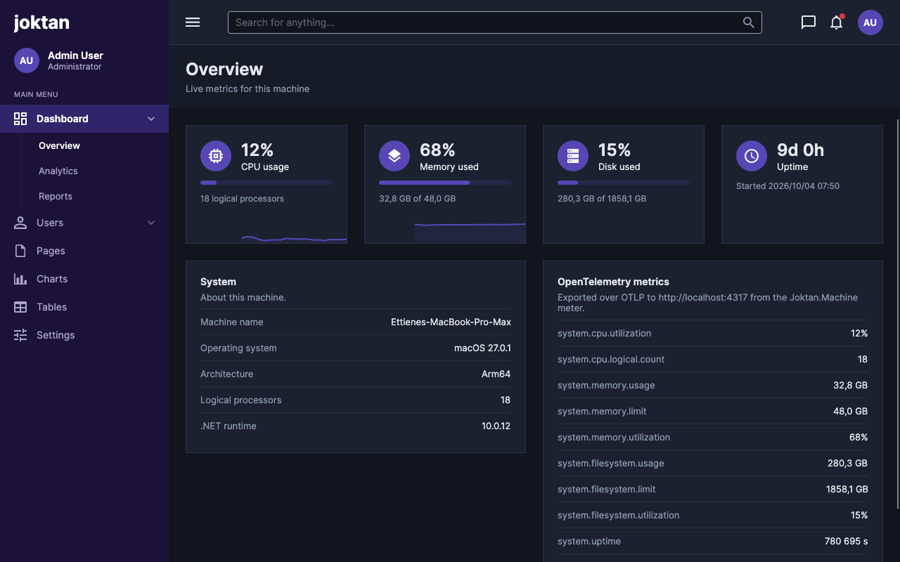

# Joktan design

Joktan uses an admin-dashboard layout: a fixed, dark muted-indigo sidebar on the left, a white top bar,
and a soft grey content area that holds white cards.

The visual reference is [`images/admin-templates.png`](images/admin-templates.png). It is a
screenshot of a third-party template and is used for layout and mood only; Joktan has its own
brand, names and menu.

Current state, showing the dashboard:

| Light | Dark |
| --- | --- |
|  |  |

## App icon

A white lower-case "j" on a rounded indigo tile, shaded from `#6F5BE0` at the top left to the
sidebar colour `#241650` at the bottom right. The vector source is
[`packaging/app-icon/joktan.svg`](../packaging/app-icon/joktan.svg); the files made from it are listed in
[`packaging/README.md`](../packaging/README.md).

The app is named "Joktan" in the macOS menu bar, which has an About Joktan item.

## Layout

```
+-----------+--------------------------------------------+
|           |  Top bar (64)                              |
|  Sidebar  +--------------------------------------------+
|  (240)    |  Page header (title, subtitle)             |
|           +--------------------------------------------+
|           |  Page content (cards, 24 padding)          |
|           |                                            |
+-----------+--------------------------------------------+
```

| Region | Size | Contents |
| --- | --- | --- |
| Sidebar | 240 wide, full height | Brand, current user, "MAIN MENU" caption, navigation |
| Top bar | 64 high | Menu toggle, search box, messages, notifications, user avatar |
| Page header | Auto height, 24 × 20 padding | Page title and subtitle (breadcrumb) |
| Page content | Fills the rest, scrolls | Cards on the app background, 24 outer margin |

The window opens at 1280 × 800 and has a minimum size of 720 × 480. The menu toggle in the top
bar hides and shows the sidebar; the content area takes the freed width.

## Colour

All colours are brushes in [`Styles/Tokens.axaml`](../Styles/Tokens.axaml) and are referenced with
`DynamicResource`, never hard-coded in views. The app follows the system light/dark setting; the
light variant is the reference design.

### Sidebar

| Token | Light | Dark | Use |
| --- | --- | --- | --- |
| `SidebarBackgroundBrush` | `#241650` | `#1A1238` | Sidebar fill |
| `SidebarActiveBrush` | `#3B2A80` | `#30246A` | Selected top-level item |
| `SidebarHoverBrush` | `#2E1E66` | `#241A4E` | Hovered top-level item |
| `SidebarDividerBrush` | `#392B6E` | `#2B2156` | Rule beside second-level items |
| `SidebarTextBrush` | `#B5ACD6` | `#ACA3CC` | Resting menu text and icons |
| `SidebarTextActiveBrush` | `#FFFFFF` | `#FFFFFF` | Brand, selected and hovered text |

### Surfaces and text

| Token | Light | Dark | Use |
| --- | --- | --- | --- |
| `AppBackgroundBrush` | `#E3E7ED` | `#12151D` | Behind the cards |
| `SurfaceBrush` | `#FFFFFF` | `#1C2130` | Top bar and cards |
| `SurfaceAltBrush` | `#F4F5F8` | `#171B27` | Page header band |
| `BorderBrush` | `#CDD4E0` | `#2C3345` | Card and top bar borders |
| `HoverBrush` | `#EDEFF4` | `#262C3D` | Hovered icon buttons |
| `TextBrush` | `#1C273C` | `#E6E9F0` | Titles and body text |
| `TextMutedBrush` | `#7987A1` | `#8D97AD` | Subtitles, captions, placeholder icons |

### Accent and data colours

These are the same in both variants.

| Token | Value | Use |
| --- | --- | --- |
| `AccentBrush` | `#5747B5` | Avatars, active tabs, primary actions. Also set as the Fluent `SystemAccentColor`. |
| `OnAccentBrush` | `#FFFFFF` | Text on the accent colour |
| `InfoBrush` | `#0D8BF2` | Data series, informational states |
| `TealBrush` | `#00C4C4` | Data series |
| `PinkBrush` | `#F10075` | Data series |
| `SuccessBrush` | `#3BB001` | Positive change badges |
| `WarningBrush` | `#E0920B` | Meter fill from 75% |
| `DangerBrush` | `#DC3545` | Meter fill from 90%, negative change badges, notification dot |
| `AccentTrackBrush`, `WarningTrackBrush`, `DangerTrackBrush` | Fill colour at about 20% opacity | Unfilled part of a meter |

Charts should take their series colours in this order: accent, info, teal, pink.

## Typography

The typeface is Inter, bundled through `Avalonia.Fonts.Inter`, so text looks the same on Windows,
Linux and macOS.

| Role | Size | Weight |
| --- | --- | --- |
| Brand | 26 | Bold |
| Page title | 24 | SemiBold |
| Body, top-level menu item | 14 | Regular (SemiBold when selected) |
| Second-level menu item, page subtitle | 13 | Regular (Medium when selected) |
| User role | 12 | Regular |
| Sidebar caption | 10 | Regular, upper case, 0.5 letter spacing |

## Spacing and shape

- Spacing uses a 4-point scale: 4, 8, 12, 16, 20, 24.
- The sidebar has 20 horizontal padding; the content area has 24.
- Cards are square-cornered with a 1-point border and 20 padding, and have no shadow.
- Icon buttons are 36 × 36 with a 4-point corner radius.
- Avatars are 36-point circles showing the user's initials on the accent colour.
- Icons are drawn on a 24 × 24 grid and shown at 18 (menu) or 20 (top bar).

## Components

Styles live in [`Styles/Shell.axaml`](../Styles/Shell.axaml) and are applied with style classes.

| Class | Control | Purpose |
| --- | --- | --- |
| `sidebar` | `Border` | Sidebar background |
| `brand` | `TextBlock` | Product name at the top of the sidebar |
| `sidebar-caption` | `TextBlock` | Section caption such as "MAIN MENU" |
| `avatar` | `Border` | Circular initials avatar |
| `nav-item` | `Button` | Top-level menu item: icon, title, optional chevron |
| `nav-children` | `Border` | Indented container for the items below a group; nests for the third level |
| `nav-subitem` | `Button` | Second- and third-level menu item |
| `topbar` | `Border` | Top bar surface |
| `icon-button` | `Button` | Borderless icon button in the top bar |
| `badge` | `Ellipse` | Unread dot over an icon button |
| `page-header` | `Border` | Band holding the page title and subtitle |
| `page-title`, `page-subtitle` | `TextBlock` | Page heading text |
| `card` | `Border` | Content panel |
| `card-title`, `card-subtitle` | `TextBlock` | Heading and description at the top of a card |
| `tile-icon` | `Border` | Round accent badge holding a stat tile's icon |
| `tile-value`, `tile-label`, `tile-detail` | `TextBlock` | Stat tile number, its name, and the supporting line |
| `meter` | `ProgressBar` | Usage bar; add `warning` or `danger` to change its state |
| `info-row`, `info-label`, `info-value` | `Border`, `TextBlock` | Label and value row inside a card |
| `field-label`, `error` | `TextBlock` | Caption above a form field; validation message beneath it |
| `code` | `TextBox`, `TextBlock` | Monospaced text for message bodies and paths |
| `small` | `Button` | Compact button for use inside table rows |
| `state-dot` | `Ellipse` | Status dot; add `ok`, `pending` or `failed` |
| `table-header`, `table-cell`, `table-row` | `TextBlock`, `Border` | Tables built from grids; add `invalid` to a cell for an error |
| `log` | `ListBox` | Bordered, selectable list of log lines |
| `compact` | `ToggleSwitch` | Switch with no On/Off caption, for a table column |
| `group-row`, `group-toggle` | `Border`, `Button` | Header of a group of table rows; the button collapses the group, and takes `collapsed` |

Menu items add the `selected` class when their view model's `IsSelected` is true.

`Sparkline` ([`Controls/Sparkline.cs`](../Controls/Sparkline.cs)) is a custom control that draws
a 2-point trend line with a faint fill beneath it, with the newest value at the right edge. The
scale runs from `Minimum` to `Maximum`, which default to 0 and 100.

## Tool windows

A tool can run in a window of its own, as the topic explorer does. Such a window:

- uses the app background and the same cards and styles as a page, without the sidebar, top bar
  or page header;
- is titled with the tool's name followed by "· Joktan";
- has no owner, so it can sit on another screen or behind the main window;
- closes when the main window closes.

The tool's content is one control hosted by both the page and the window, so it looks and behaves
the same in either.

## Dashboard

The Overview page shows the state of the local machine and refreshes every two seconds.

- **Stat tiles.** A row of four: CPU usage, memory used, disk used and uptime. Each has an icon,
  the current value at 24 SemiBold, its name, and one supporting line.
- **Meters.** The three usage tiles carry a meter. Its fill is the accent colour, turning to
  warning at 75% and danger at 90%; the track is the same colour at low opacity. The percentage
  is always shown as text, so the state never depends on colour alone.
- **Trends.** CPU and memory show a sparkline of the last 30 samples (one minute) along the
  bottom edge of the tile.
- **Detail cards.** Below the tiles, two cards of label and value rows: facts about the machine,
  and the OpenTelemetry instruments with their latest values.

Data marks use the accent colour only. Values and labels stay in the text colours.

What the dashboard shows and how each value is calculated is specified in
[features/dashboards/spec.md](features/dashboards/spec.md).

## Navigation

- The menu has up to three levels. An entry either opens a page or is a group with children, and
  a second-level entry can itself be a group, as in Dev Tools / Connectivity / MQTT.
- Clicking a group expands or collapses it; several groups can be open at once.
- Clicking a leaf selects it and shows its page. Every group above the selected leaf is
  highlighted as well.
- The page subtitle shows the path, for example "Dashboard / Overview".

The menu is defined in `MainViewModel`. `MainViewModel.CurrentPage` holds the view model of the
page being shown, and `ViewLocator` resolves it to the view of the same name
(`FooViewModel` → `FooView`).

## What is implemented

- The shell: sidebar, top bar and page header.
- The dashboard at Dashboard / Overview.
- The MQTT publisher at Dev Tools / Connectivity / MQTT.
- The topic explorer at Dev Tools / Connectivity / Topic Explorer, which can also run in its own
  window.

Every other menu entry opens the same placeholder page (`PageView`), and the menu entries, user
name and role are placeholders.

Not built yet:

- The remaining pages and their view models
- Search, messages, notifications and the user menu (the controls are present but do nothing)
- Charts, tables and page tabs from the reference image
- A compact icon-only sidebar and a manual light/dark switch
