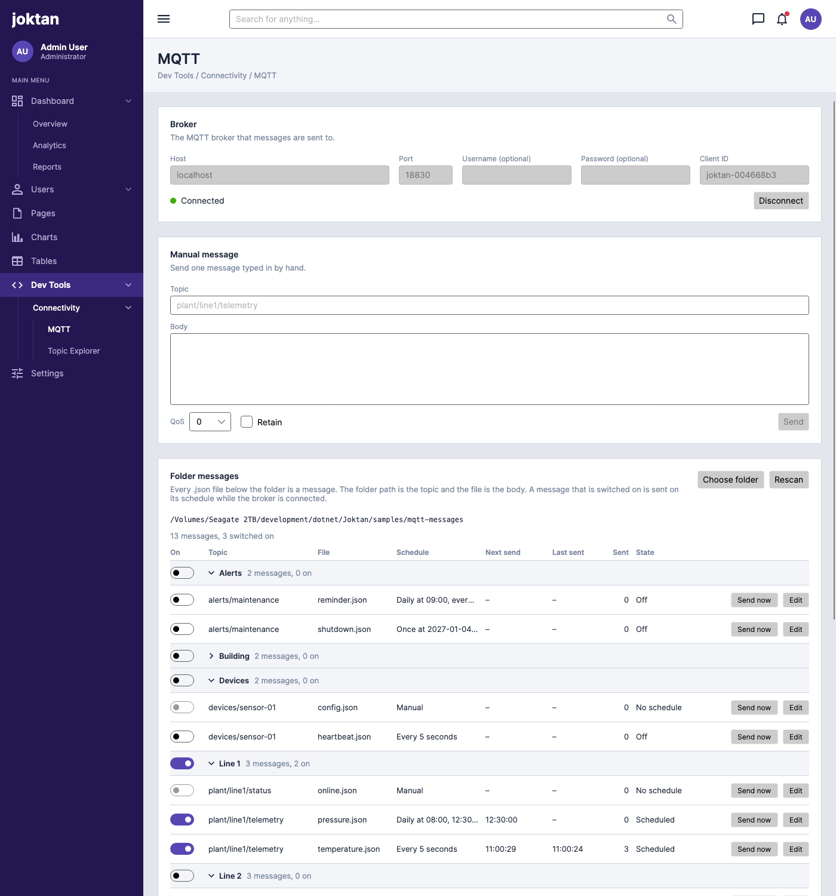

# MQTT publisher

A developer tool for sending test messages to an MQTT broker. Messages are either typed in by
hand or read from a folder of JSON files, and folder messages can be sent on a schedule with
fields that change on every send.

| Item      | Value                           |
|-----------|---------------------------------|
| Menu path | Dev Tools / Connectivity / MQTT |
| Status    | Implemented                     |



## Purpose

Let a developer exercise a system that consumes MQTT messages without writing a script: point
Joktan at a broker, point it at a folder of sample messages, and have them published once or
repeatedly with fresh timestamps and identifiers.

## Page layout

From top to bottom:

1. Page header: title "MQTT", subtitle "Dev Tools / Connectivity / MQTT".
2. **Broker** card: connection settings and connection state.
3. **Manual message** card: send one message typed in by hand.
4. **Folder messages** card: the chosen folder and the messages found in it, in groups, each
   with a switch to turn its schedule on.
5. **Activity** card: a log of what was sent and what failed.

## Broker connection

### Settings

| Setting   | Required | Default                                   | Rules                                                |
|-----------|----------|-------------------------------------------|------------------------------------------------------|
| Host      | Yes      | Empty                                     | An IPv4 or IPv6 address, or a host name              |
| Port      | Yes      | `1883`                                    | A whole number from 1 to 65535                       |
| Username  | No       | Empty                                     | Sent only when filled in                             |
| Password  | No       | Empty                                     | Shown masked; sent only when a username is filled in |
| Client ID | No       | `joktan-` followed by 8 random characters | Generated once and then kept                         |

The settings are saved shortly after they change, and again when the app exits, and are restored
the next time it starts. The password is saved after a successful connection, in the operating
system's credential store (see [Decisions to confirm](#decisions-to-confirm)).

Everything else the page remembers is kept in one file, `mqtt.json`, in a `Joktan` folder under
the user's application data folder: `%APPDATA%` on Windows, `~/Library/Application Support` on
macOS and `~/.config` on Linux. Setting the `JOKTAN_DATA_DIR` environment variable keeps it in
that folder instead.

### Connecting

- **Connect** is enabled when host and port are valid. **Disconnect** replaces it while connected,
  and reads **Cancel** during the first attempt. Disconnecting stops all scheduled sending.
- The settings cannot be edited while connecting or connected.
- A connection attempt that gets no answer within 10 seconds fails.
- If an established connection drops, Joktan tries again every 5 seconds until it succeeds or the
  user presses **Disconnect**.
- Joktan does not connect by itself when the app starts.

### Connection state

The card shows one of these states, as text beside a coloured dot:

| State        | Meaning                                                                                                     |
|--------------|-------------------------------------------------------------------------------------------------------------|
| Disconnected | No connection, and none being attempted                                                                     |
| Connecting   | First attempt in progress                                                                                   |
| Connected    | Ready to send                                                                                               |
| Reconnecting | The connection dropped and is being retried                                                                 |
| Failed       | The last attempt did not succeed; the reason is shown, for example "Not authorized" or "Connection refused" |

## Manual messages

A form for sending a single message:

| Field  | Required | Default | Rules                                                                             |
|--------|----------|---------|-----------------------------------------------------------------------------------|
| Topic  | Yes      | Empty   | A valid publish topic (see [Topic rules](#topic-rules))                           |
| Body   | No       | Empty   | Any text. If it parses as JSON it is shown formatted; it does not have to be JSON |
| QoS    | Yes      | `0`     | 0, 1 or 2                                                                         |
| Retain | Yes      | Off     | On or off                                                                         |

- **Send** publishes the message once. It is enabled only while connected and the topic is valid.
- The form keeps its contents after sending, so the same message can be sent again.
- The last topic and body are remembered between runs.
- Each send appears in the activity log.

## Folder messages

### Choosing the folder

- **Choose folder** opens the system folder picker. The chosen path is shown in the card and
  remembered between runs.
- The folder is scanned when it is chosen, when the app starts, and whenever a file in it is
  added, changed, renamed or removed. **Rescan** does the same on demand.
- If the folder no longer exists or cannot be read, the card says so and lists no messages.

### How files become messages

Every `.json` file below the chosen folder is one message, except settings files (see
[Message settings](#message-settings)).

- The **topic** is the path of the folder that holds the file, relative to the chosen folder,
  with `/` between the parts. The file name is not part of the topic.
- The **body** is the content of the file.
- Several files in one folder are several messages on the same topic.

Example, with `C:\mqtt-samples` as the chosen folder:

```
mqtt-samples/
├── plant/
│   └── line1/
│       ├── telemetry/
│       │   ├── temperature.json        topic: plant/line1/telemetry
│       │   ├── temperature.send.json   settings for temperature.json
│       │   └── pressure.json           topic: plant/line1/telemetry
│       └── status/
│           └── online.json             topic: plant/line1/status
└── readme.json                         skipped: not inside a topic folder
```

A file is listed but marked invalid, and never sent, when:

- it sits directly in the chosen folder, so it has no topic;
- its folder path is not a valid topic (see [Topic rules](#topic-rules));
- it is not valid JSON;
- its settings file is not valid, or names a field that is not in the body.

The reason is shown in the message list.

### Topic rules

- Folder names are used exactly as written, including upper and lower case and spaces.
- A topic may not contain `+` or `#`, may not be empty, and may not be longer than 65,535 bytes
  in UTF-8.
- On Windows the path separator `\` becomes `/`.

### Message settings

A message is only sent by hand until it has a schedule and is switched on. Settings are edited in the app and stored in a
file beside the message, named after it with `.send.json` in place of `.json`. Keeping them in
the folder means a set of sample messages can be copied or put under version control complete
with its schedules.

`temperature.json`, the body:

```json
{
  "ts": 0,
  "serial": "",
  "sequence": 0,
  "sensor": { "id": "T-100", "value": 21.5 }
}
```

`temperature.send.json`, its settings:

```json
{
  "enabled": true,
  "group": "Line 1",
  "qos": 1,
  "retain": false,
  "schedule": { "type": "interval", "every": 5, "unit": "seconds" },
  "fields": {
    "ts": { "type": "unixSeconds" },
    "serial": { "type": "guid" },
    "sequence": { "type": "counter", "start": 1, "step": 1 },
    "sensor.value": { "type": "randomNumber", "min": 18, "max": 26, "decimals": 1 }
  }
}
```

| Setting    | Default | Meaning                                                                    |
|------------|---------|----------------------------------------------------------------------------|
| `enabled`  | `false` | Whether the message is switched on. This is the switch in the message list |
| `group`    | Empty   | The group the message is listed under (see [Groups](#groups))              |
| `qos`      | `0`     | 0, 1 or 2                                                                  |
| `retain`   | `false` | Whether the broker keeps the message for new subscribers                   |
| `schedule` | Manual  | When the message is sent (see [Schedules](#schedules))                     |
| `fields`   | None    | Which fields change on each send (see [Varying fields](#varying-fields))   |

### Schedules

Each message has one schedule:

| Type     | Recurring | Settings                                                                                                    | Sent                                                                                   |
|----------|-----------|-------------------------------------------------------------------------------------------------------------|----------------------------------------------------------------------------------------|
| Manual   | No        | None                                                                                                        | Only when the user presses **Send now**                                                |
| Once     | No        | Date and time                                                                                               | One time, at that moment                                                               |
| Interval | Yes       | Every *N* seconds, minutes or hours; optional start and end date and time; optional maximum number of sends | First at the start time, or as soon as the run starts if none is given, then every *N* |
| Daily    | Yes       | One or more times of day; the days of the week it applies to                                                | At each of those times on each of those days                                           |

As stored in the settings file:

```json
{ "type": "manual" }
{ "type": "once", "at": "2026-11-02T08:30:00" }
{ "type": "interval", "every": 5, "unit": "seconds", "start": "2026-11-02T08:00:00", "end": "2026-11-02T17:00:00", "maxSends": 1000 }
{ "type": "daily", "times": ["08:00", "12:30"], "days": ["mon", "tue", "wed", "thu", "fri"] }
```

Rules:

- Dates and times are in the computer's local time zone.
- The shortest interval is 1 second.
- A message is sent on its schedule while two things are true: it is switched on, and the broker
  is connected. There is no separate start button.
- Its schedule starts from the moment both become true: when it is switched on while connected,
  or when the broker is connected while it is on. Its sent count and counters start again then.
- A message that is switched on while the broker is not connected shows "Waiting for connection".
- If the connection is lost and comes back by itself, schedules carry on where they were. A send
  that falls due while the connection is down is skipped and written to the activity log.
- A send that falls due while the message is switched off, the broker is disconnected or the app
  is closed is skipped. It is never sent late.
- A "once" message whose time has already passed when its schedule starts is not sent, and is
  shown as "Missed".
- An interval message stops when it reaches its end time or its maximum number of sends, and is
  shown as "Finished". Switching it off and on begins the count again.
- Changing a message's file or settings while it is being sent takes effect from its next send.
- Switches are saved, so a message left on is sent again as soon as the broker is connected,
  including after the app is restarted.

### Varying fields

A varying field is a field of the JSON body whose value is replaced each time the message is
sent. Everything else in the body is sent as written.

A field is named by its path from the top of the body: `ts`, `sensor.value`, `readings[0].ts`.
The field must already be present in the body; its value there is only a placeholder.

| Type               | Settings                                | Value sent                                                    | JSON type | Example                                  |
|--------------------|-----------------------------------------|---------------------------------------------------------------|-----------|------------------------------------------|
| `unixSeconds`      | None                                    | Current time as seconds since 1970-01-01 UTC                  | Number    | `1793606400`                             |
| `unixMilliseconds` | None                                    | Current time as milliseconds since 1970-01-01 UTC             | Number    | `1793606400123`                          |
| `isoTimestamp`     | None                                    | Current time in UTC, ISO 8601                                 | String    | `"2026-11-02T08:00:00.123Z"`             |
| `guid`             | None                                    | A new random GUID                                             | String    | `"3f2b8c1e-9a47-4d1b-8e0a-6c5d2f7b9a10"` |
| `counter`          | `start` (default 1), `step` (default 1) | `start` on the first send, then increased by `step` each send | Number    | `1`, `2`, `3`                            |
| `randomInteger`    | `min`, `max`                            | A whole number from `min` to `max` inclusive                  | Number    | `42`                                     |
| `randomNumber`     | `min`, `max`, `decimals` (default 2)    | A number from `min` to `max`, rounded to `decimals` places    | Number    | `21.5`                                   |
| `oneOf`            | `values`, a list                        | One of the listed values, picked at random                    | As listed | `"open"`                                 |

Rules:

- All time-based fields in one message use the same instant, taken at the moment of sending.
- A counter belongs to one field of one message. It returns to `start` when the message's
  schedule starts again.
- A GUID is new on every send. A value that must stay the same across sends is written directly
  in the body instead.
- Varying fields apply to **Send now** as well as to scheduled sends.
- A message with no varying fields is sent exactly as the file is written. One with varying
  fields is sent as compact JSON, without the file's line breaks and indentation.

### Message list

The Folder messages card lists every message found, under its group, sorted by topic and then
file name:

| Column    | Shows                                                                                     |
|-----------|-------------------------------------------------------------------------------------------|
| On        | A switch. On means the message is sent on its schedule while connected                    |
| Topic     | The topic derived from the folder path                                                    |
| File      | The file name                                                                             |
| Schedule  | A summary, for example "Every 5 seconds" or "Daily at 08:00, Mon–Fri"                     |
| Next send | When it is next due, or "–"                                                               |
| Last sent | When it was last sent in this session, or "–"                                             |
| Sent      | How many times it has been sent since it was last switched on or the broker was connected |
| State     | See below                                                                                 |

The card also shows the totals, for example "13 messages, 3 switched on".

**The switch.**

- Every message starts switched off. A new file, or one with no settings file, is off.
- Turning a switch on or off saves it to the message's `.send.json` file straight away, creating
  the file if there is none.
- Only a message with a schedule can be switched on. For a message with a manual schedule the
  switch is greyed out; give it a schedule with **Edit** first.
- The switch for an invalid message is greyed out.

**State.**

| State                  | Meaning                                                            |
|------------------------|--------------------------------------------------------------------|
| No schedule            | The schedule is manual; the message is only sent with **Send now** |
| Off                    | It has a schedule but is switched off                              |
| Waiting for connection | It is switched on, and will start when the broker is connected     |
| Scheduled              | It is being sent; **Next send** shows when                         |
| Finished               | It has reached its end time or maximum number of sends             |
| Missed                 | Its one send time passed before it could be sent                   |
| Invalid                | It cannot be sent; the reason follows                              |

Each row has two actions:

- **Send now** publishes the message once, immediately. It is enabled while connected and the
  message is valid, whether the message is switched on or off.
- **Edit** opens the message's settings: group, switched on, QoS, retain, schedule and varying
  fields. It also shows a preview of the body with the varying fields filled in. Saving writes
  the `.send.json` file. It is available whenever the message file is valid JSON; if the existing
  settings file is not valid, the editor starts from the defaults and saving replaces it.

### Groups

Messages can be put into named groups, to keep related ones together and switch them as one.

- A message's group is set in **Edit**, by typing a new name or picking one already in use. It is
  stored as `group` in the message's settings file. Group names ignore case.
- Each group has a header row showing its name and a summary such as "3 messages, 2 on".
- Groups are listed in alphabetical order. Messages with no group come last, under "Ungrouped".
- The switch in a group's header turns every message in the group on or off. It only affects
  messages that have a schedule. It shows on when all of those are on.
- Clicking a group's name collapses or expands it. Collapsed groups stay collapsed while the app
  is running, and their messages carry on being sent.
- A group exists as long as at least one message names it; there is nothing to create or delete
  separately.

## Activity log

A list of the most recent 500 events, newest first, kept for the current session only:

| Column | Shows                                                          |
|--------|----------------------------------------------------------------|
| Time   | Local time, to the second                                      |
| Event  | Sent, Failed, Skipped, Connected, Disconnected or Reconnecting |
| Topic  | The topic, for message events                                  |
| Source | "Manual", or the file name                                     |
| Detail | The size of the body, or the reason for a failure or skip      |

Selecting a sent message shows the exact body that was published. **Clear** empties the log.

## Telemetry

The feature reports to OpenTelemetry through a `Joktan.Mqtt` meter:

| Instrument                     | Kind    | Unit        | Meaning                                                               |
|--------------------------------|---------|-------------|-----------------------------------------------------------------------|
| `joktan.mqtt.messages.sent`    | Counter | `{message}` | Messages published, with a `source` attribute of `manual` or `folder` |
| `joktan.mqtt.messages.failed`  | Counter | `{message}` | Messages the broker did not accept                                    |
| `joktan.mqtt.messages.skipped` | Counter | `{message}` | Scheduled sends skipped because there was no connection               |
| `joktan.mqtt.connected`        | Gauge   | `1`         | 1 while connected, otherwise 0                                        |

Topics and message bodies are never included in telemetry.

## Implementation

| Part                         | File                                                                             |
|------------------------------|----------------------------------------------------------------------------------|
| Page                         | `Views/MqttView.axaml`, `ViewModels/MqttViewModel.cs`                            |
| Settings editor              | `Views/MessageSettingsWindow.axaml`, `ViewModels/MessageSettingsViewModel.cs`    |
| Broker connection            | `Mqtt/MqttConnection.cs` (uses the MQTTnet library)                              |
| Message list rows and groups | `ViewModels/FolderMessageRowViewModel.cs`, `ViewModels/MessageGroupViewModel.cs` |
| Folder scanning              | `Mqtt/FolderScanner.cs`, `Mqtt/FolderMessage.cs`                                 |
| Schedules                    | `Mqtt/MessageSchedule.cs`, `Mqtt/FolderPublisher.cs`                             |
| Settings file format         | `Mqtt/MessageSettings.cs`                                                        |
| Varying fields               | `Mqtt/VaryingFields.cs`                                                          |
| Saved settings               | `Mqtt/MqttSettings.cs`, `Mqtt/CredentialStore.cs`                                |
| Telemetry                    | `Mqtt/MqttMetrics.cs`                                                            |

A broker for local testing is in [`containers/`](../../../../../containers/README.md), and a folder
of example messages in [`samples/mqtt-messages`](../../../../../samples/README.md).

Checked on macOS against Mosquitto 2 running under Podman. The Windows Credential Manager and
Linux Secret Service password stores are implemented but have not been run.

## Not included

- Showing received messages; that is the [topic explorer](../topic-explorer/spec.md)
- TLS, client certificates and MQTT over WebSockets
- More than one broker or more than one folder at a time
- MQTT 5 features such as user properties and message expiry
- Folder messages with a body that is not JSON
- Cron expressions and schedules that depend on other messages
- Catching up on sends that were missed

## Decisions to confirm

These were not stated in the request and are the choices this spec makes. All are implemented as
written:

1. **The file name is not part of the topic.** The topic is the folder path only, as requested;
   two files in one folder publish to the same topic.
2. **Schedules and varying fields live in a `.send.json` file beside each message**, not in the
   app's own settings, so a folder is self-contained. The message file stays a plain body.
3. **The password is kept in the operating system's credential store** (Windows Credential
   Manager, macOS Keychain, the Secret Service on Linux through `secret-tool`). Where none is available it is not
   saved and has to be typed in again each run. It is never written to a settings file.
4. **No TLS in this version.** The port defaults to 1883, the unencrypted MQTT port, so the
   username and password travel in clear text. This suits a broker on a local or trusted network
   only.
5. **Missed sends are skipped, not sent late**, so a restart never produces a burst of old
   messages.
6. **Groups are named by the user**, per message, rather than taken from the folder structure,
   so a group can span topics.
7. **There is no Start button.** A message's switch is the only control: on means it is sent
   whenever the broker is connected. An earlier version needed Start to be pressed as well, which
   made it easy to believe messages were scheduled when nothing was being sent.
8. **Switches are saved.** A message left on resumes as soon as the broker is connected, even
   after a restart. Switch a group off before connecting to a broker you do not want to send to.
